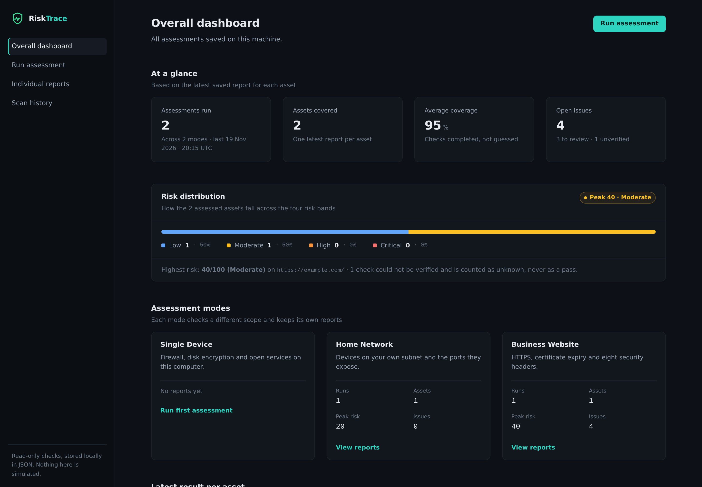
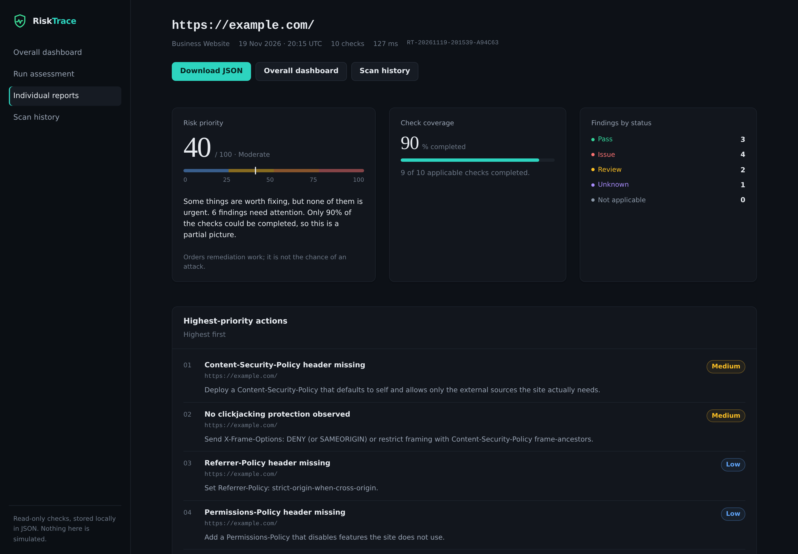

# RiskTrace

**Check how exposed a device, a home network, or a website is — and what to fix first.**

RiskTrace runs real, read-only security checks, records the evidence behind every result,
ranks the problems by how much they matter, and keeps each report so you can compare against
the last run. No JavaScript anywhere: HTML + one CSS file, Python, and JSON on disk.

This is the only document in the project. Everything needed to run it, understand a result
and deploy it is below.

| | |
|---|---|
| **Tests** | 111 passing |
| **Dependencies** | Flask only · no JavaScript · no external services · no API keys |
| **Runs on** | Python 3.10+ · Windows, Linux, macOS |
| **Nmap** | Optional — falls back to a built-in scanner |
| **Licence** | MIT |





## Start it

| Your machine | Do this |
|---|---|
| Windows | double-click **`run.bat`** |
| Linux / macOS | `./run.sh` |

First run creates a `.venv`, installs Flask, and opens `http://127.0.0.1:5000`.

Or by hand:

```bash
python -m venv .venv && source .venv/bin/activate    # Windows: .venv\Scripts\activate
pip install -r requirements.txt
python app.py
```

**Nmap is optional.** Home Network works on a bare machine using the built-in threaded TCP
scanner (103 common ports). If Nmap is installed it is used instead (20 ports, real scan
technique, faster). Whichever engine ran is recorded in the report.

---

## Deploy it

Two commands on any fresh Ubuntu VM — the script installs Docker, opens the host firewall,
builds the image, starts the container with a generated upload token, and prints the URL when
`/healthz` answers. Safe to re-run.

```bash
scp -r . user@your-server:/srv/risktrace
ssh user@your-server 'cd /srv/risktrace && bash deploy.sh'
```

The provider's own firewall is the one thing it cannot open — allow TCP 80 in the console
(Oracle: VCN Security List).

Without Docker:

```bash
pip install -r requirements.txt
RISKTRACE_HOSTED=1 gunicorn app:app --bind 0.0.0.0:8000 --workers 1 --threads 8 --timeout 700
```

`--workers 1` is deliberate: the history is one JSON file guarded by an in-process lock.
Reports persist at `/srv/risktrace-data/assessment_history.json`; the upload token is at
`/srv/risktrace/.risktrace-token`.

**On a hosted instance, Home Network scans the server's subnet, not the visitor's.** A server
cannot reach your LAN, so that mode is only meaningful when run locally — the app says so when
`RISKTRACE_HOSTED=1` rather than producing a meaningless result about the server itself.

## Put it on GitHub

Create a public repo with no README/.gitignore/licence, then use *"uploading an existing
file"* and drag in the folder contents. GitHub does not unpack an uploaded zip, and the file
picker hides dot files — confirm `.gitignore`, `.gitattributes` and `.dockerignore` arrived.

---

## The three assessments

| Mode | Runs | Checks | Best for |
|---|---|---|---|
| **Single Device** | Download only | Firewall on? Disk encrypted? Anything reachable from the network? | Your own laptop or PC |
| **Home Network** | In the app | Live hosts on your subnet, and 103 common TCP ports on each | Knowing what is on your network |
| **Business Website** | In the app | HTTPS, certificate expiry, and eight security headers, judged by value not presence | Your own site's browser-side setup |

Single Device is a download because a web server cannot see your laptop's firewall — putting
it behind a button would mean making the result up. It is one plain-Python file, standard
library only, and it makes no network connection unless you ask it to upload.

Anything that cannot be verified is reported as **Unknown**, never as Pass. A score of 0 means
"nothing wrong was observed", never "this is secure".

---

## Project structure

Six folders. Everything that analyses or checks lives under `analyzer/`.

```
RiskTrace/
├── app.py                     # routes, forms, orchestration only
├── risktrace_device_scan.py   # the downloadable scanner (generated, committed)
├── analyzer/
│   ├── finding_schema.py      # one finding shape, shared by all three modes
│   ├── risk_engine.py         # scoring: the only place a score is computed
│   ├── report_service.py      # JSON history store
│   ├── dashboard_service.py   # aggregate figures for the dashboard
│   ├── agent_builder.py       # builds the downloadable scanner (`python -m analyzer.agent_builder`)
│   ├── rules.json             # 46 rules: weights, thresholds, recommendations
│   ├── history.json           # the report store (ships empty)
│   └── checks/
│       ├── single_device.py   # mode: firewall, encryption, listening services
│       ├── home_network.py    # mode: discovery + ports (IPv4 and IPv6)
│       ├── business_website.py# mode: HTTPS, headers, certificate
│       ├── nmap_scanner.py    # probe: Nmap wrapper
│       ├── local_scanner.py   # probe: built-in TCP scanner (no Nmap needed)
│       ├── ipv6_neighbors.py  # probe: neighbour table
│       └── web_checker.py     # probe: HTTP + TLS
├── templates/                 # 8 pages, no JavaScript
├── static/                    # one CSS file, the logo, two screenshots
└── tests/                     # 111 tests
```

That is the whole project. Two documents: this README and `NOTES.md` (commands, settings,
and what to do when something looks wrong).

## One assessment, start to finish

```
form POST ──▶ app.run_assessment
             ├─ mode validation
             ├─ analyzer/checks/*.run(form, rules)   ← live checks, evidence collected
             ├─ analyzer.finding_schema              ← normalize + validate every finding
             ├─ analyzer.risk_engine.analyze         ← priority, score, coverage, actions
             ├─ analyzer.report_service.create       ← atomic append to JSON history
             └─ redirect to /report/<id>             ← viewing a report never rescans
```

## Screens

Four destinations, plus one report page per assessment. Every figure is computed from saved
JSON; a screen with no matching reports renders a genuine empty state instead of zeros.

| Route | Screen | What it shows |
|---|---|---|
| `/` | **Overall dashboard** | Assessments, assets, average coverage, open issues; one card per mode; risk distribution; latest result per asset |
| `/assessment` | **Run assessment** | Mode picker. Home Network and Business Website run their forms here; Single Device is a download card |
| `/reports` | **Individual reports** | Every completed assessment, filterable by mode, with score, band and coverage |
| `/history` | **Scan history** | The same records as a chronological timeline, including repeat runs of one asset |
| `/report/<id>` | **One report** | Score, coverage, status counts, prioritized actions, per-device results, findings with raw evidence |
| `/agent` | **Assess your own device** | Download the standalone scanner, with optional token-gated upload |
| `/healthz` | Health check | For the container |

Other routes: `POST /assessment/run`, `POST /agent/report` (token-gated, 404 without a token),
`/report/<id>/download`, `/download/risktrace_device_scan.py`.

Buttons that are not implemented — delete history, retry, PDF export — are not displayed.

---

## Scoring, in one screen

```
priority = 100 × (0.40·severity/10 + 0.25·impact/5 + 0.20·likelihood/5 + 0.15·exposure/3) × confidence
score    = 0.7 × max(weight) + 0.3 × (Σ weight² / Σ weight)      where weight = priority + severity_weight
```

The worst finding dominates; the evidence-weighted average stops many trivial findings from
inflating the total. Only `issue` and `review` carry a priority — `pass`, `unknown` and
`not_applicable` never score. Bands: `0–24 Low`, `25–49 Moderate`, `50–74 High`,
`75–100 Critical`. Coverage is measured separately, so "High risk on 40 % coverage" is visible
rather than hidden.

**This ranks remediation work. It is not the probability of an attack.**

Worked example, a real `enc.disabled` finding: severity high 7/10 → `0.40 × 0.70 = 0.280`,
impact 5/5 → `0.250`, likelihood 2/5 → `0.080`, exposure local 1/3 → `0.050`; sum `0.660`,
times confidence 0.90 = **59.4**. With one other finding at 19.2 the asset scores
`0.7 × 66.4 + 0.3 × (66.4² + 20.2²)/86.6 =` **63, High**.

## Safety controls

1. Home Network accepts **private IPv4/IPv6 ranges only** — public addresses are refused before a packet is sent.
2. Business Website accepts **public URLs only** — loopback, private, link-local and metadata addresses are refused on every redirect hop.
3. `subprocess` argument lists only — never a shell string.
4. Timeouts on every command and request; 64 KB response cap; 3 redirects; 8 s HTTP timeout.
5. Caps: 256 addresses per subnet, 128 hosts scanned (64 with the built-in engine), 103 TCP ports.
6. TLS verification is never disabled.
7. Jinja auto-escaping, CSP with `script-src 'none'`, `nosniff`, `Referrer-Policy`, no stack traces in the browser.
8. Authorization checkbox required for network and website assessments; rate limited per address.
9. Read-only checks only — no exploitation, brute force, or destructive tests.

**What is stored, and how to protect it.** The history is one JSON file holding targets and
findings in plain text. For local use it is your own file on your own disk. On a server: put
HTTPS in front (the upload token travels in a header), keep the file on an encrypted volume
(Full-disk encryption is enough; Oracle block volumes are encrypted by default), and set a
retention policy — nothing prunes history by itself:

```bash
# delete reports older than 90 days — weekly cron
python - <<'EOF'
import json, datetime, pathlib
p = pathlib.Path("/srv/risktrace-data/assessment_history.json")
data = json.loads(p.read_text())
cutoff = (datetime.datetime.now(datetime.timezone.utc) - datetime.timedelta(days=90)).isoformat()
data["assessments"] = [r for r in data["assessments"] if r["completed_at"] >= cutoff]
p.write_text(json.dumps(data, indent=2))
EOF
```

Treat a stored report as personal data: a hostname plus a list of open ports identifies
somebody's machine. Never commit a history file containing someone else's results.

## Known limitations

These are boundaries of a deliberately small scope, not defects being excused.

- **Not a vulnerability scanner.** It observes configuration; it never sends exploit payloads,
  fuzzes inputs, or matches versions against CVE feeds. It is not a penetration test, not a
  compliance audit, and not a monitor — it runs when a human submits a form.
- **Device checks are Windows and Linux only.** macOS returns *Not Applicable*. BitLocker
  queries need elevation; without it the result is *Unknown*.
- **Firewall state, not firewall rules.** An enabled firewall with an allow-everything rule
  reports as a pass. Encryption *state*, not key handling or recovery-key storage.
- **Home Network checks 103 TCP ports** (20 with Nmap) and no UDP. Ranges cap at 256
  addresses; port scanning stops at 128 hosts (64 with the built-in engine) and the remainder
  are listed as skipped. Devices behind another router or on a guest VLAN are invisible.
- **IPv6 reads the neighbour cache, not a sweep.** A `/64` holds 18 quintillion addresses, so
  it only finds devices that have already talked to the scanning machine — silent IoT devices
  are routinely missing. Ports *are* checked for every device it finds.
- **Nmap is optional.** The built-in scanner covers more ports (103 vs 20) but only does a TCP
  connect scan — no SYN scan, OS fingerprinting, version detection or script scanning.
- **Website checks judge one URL, one response,** with up to 3 redirects. No crawling, no
  vulnerability testing. A site with every header but an unpatched CMS scores clean. Old TLS
  versions may be untestable when the local OpenSSL refuses to offer them — reported as
  *unknown*, never a pass.
- **The score is a heuristic, not CVSS.** `0.7 × max + 0.3 × evidence-weighted average`, with
  fixed, uncalibrated bands. "Unknown" is not zero: a report full of unknowns can score lower
  than one confirmed issue, so read the counts, not only the score.
- **One JSON file, one process.** Correct for the documented `--workers 1` deployment;
  multiple worker processes would race. No retention limit and no encryption at rest by
  default.
- **A hosted instance scans the server's subnet**, not the visitor's — the app says so when
  `RISKTRACE_HOSTED=1`. Rate limits are per-process and in-memory. No authentication: anyone
  who can reach the app can run an assessment and read history.
- **Not verified:** real Nmap output (both parsers run against a stub that emits Nmap's
  documented formats), the built-in scanner against a physical home LAN (tested on loopback
  sockets), Windows and macOS (`PowerShell`/`netsh` paths tested against synthetic output;
  `run.bat` never executed), and load or multi-worker behaviour.
- **No ML:** the PRD requires a validated dataset, labels and a held-out evaluation before ML
  may be added, so this release ships the deterministic rule engine only.

## Numbers measured on this build

| Measured | Result |
|---|---|
| Runtime dependencies | Flask only (104 KB wheel); Nmap optional |
| Cold start to a listening socket | 0.30 s |
| Standalone scanner imports | standard library only — no pip install |
| JavaScript in any template | none |
| Page weight | 6 KB HTML + one 32 KB CSS file |
| Rules | 46 in one readable JSON file |
| External services called | none — no API keys, no accounts, no telemetry |
| Outbound connections in device mode | **0** (verified by intercepting `connect`) |

## Working on it

House rules, in priority order:

1. **No invented data.** If a check cannot be performed the finding is `unknown` or
   `not_applicable` — never `pass`, never a made-up value.
2. **No JavaScript**, for charts, forms, navigation or filtering. CSS-only motion, off under
   `prefers-reduced-motion`.
3. **No new dependency** that fails the question "what breaks without it?" The runtime is
   Flask plus the standard library.
4. **Every visible button has a route.** No control that does nothing.
5. **Scoring lives in one place** — `analyzer/risk_engine.py`. A mode that computes a score
   has broken the design. Modes return findings; `app.py` orchestrates and never checks.

Before you commit:

```bash
python -m unittest discover -s tests     # 111 tests, expected OK
python -m pyflakes .                     # expected: no output
python -m analyzer.agent_builder         # only if a check under analyzer/checks/ changed
```

**Add a device check:** add the rule to `analyzer/rules.json` (id, severity, impact,
likelihood, exposure, confidence, recommendation), implement it in
`analyzer/checks/single_device.py`, then run `python -m analyzer.agent_builder` so the downloadable
scanner picks it up.

**Add a page:** route in `app.py`, template extending `base.html`, and a row in the Screens
table above. The navigation has exactly four destinations — a fifth is a product decision,
not a coding one.

**Never commit:** `.venv/`, `__pycache__/`, `*.pyc`, `.risktrace-token`, or a history file
containing someone else's scan results.

## Presenting it

1. **Dashboard** — "10 assessments, 6 assets, 94 % average coverage; all of it computed from
   saved reports, none typed in."
2. **Business Website** — enter a URL you own, submit, watch it run live.
3. **The report** — point at the score, the band, the coverage, then open one finding and show
   its evidence: the check, the observed value, the timestamp.
4. **Scan history** — earlier runs are still there, including other days.

Do not claim: an APK (there is no Android app), that it scans your home network from the cloud
(a server cannot reach your LAN), that it works on any device (Windows and Linux only), or that
AI analyses the results (there is no model — the score is a documented formula).
